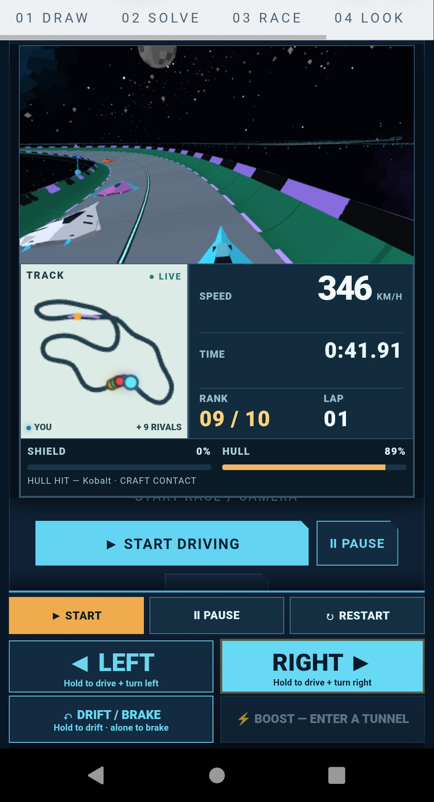
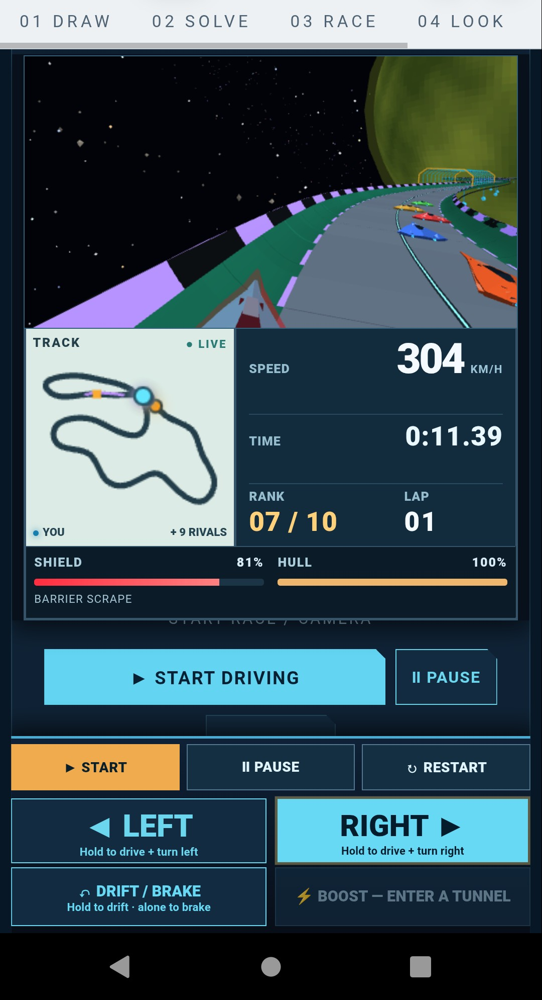
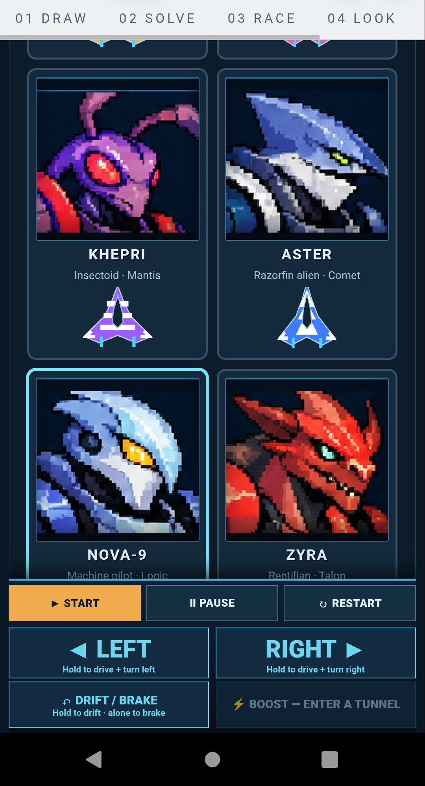
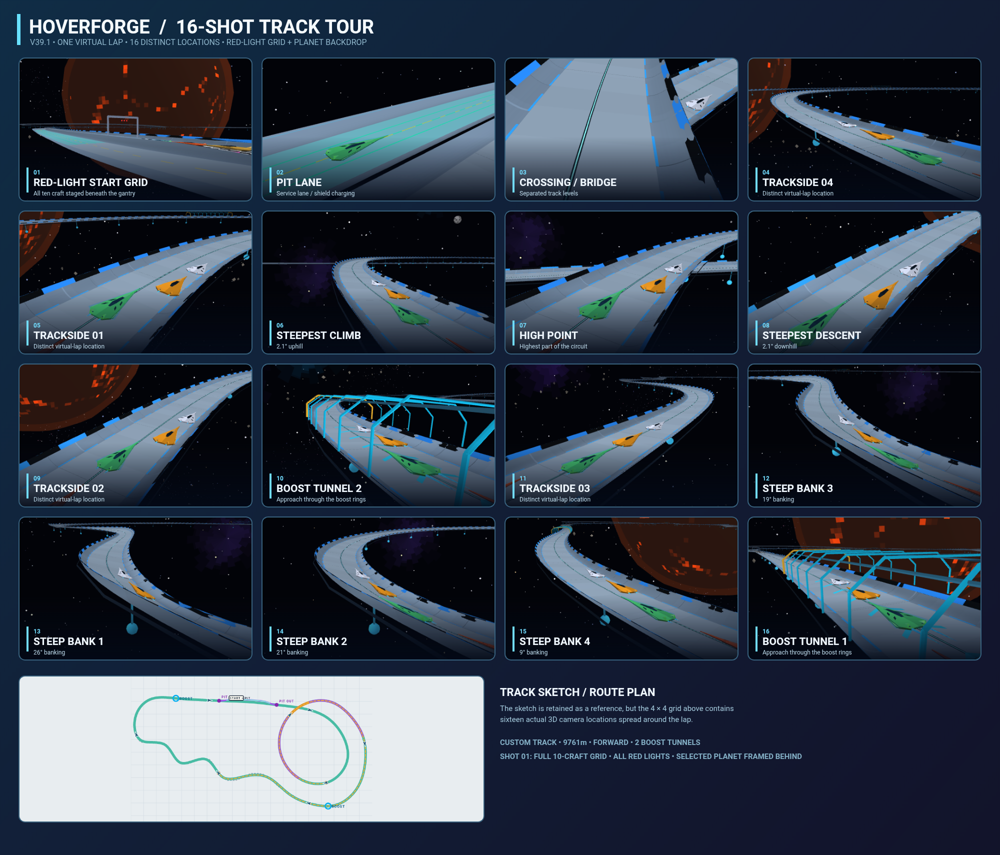
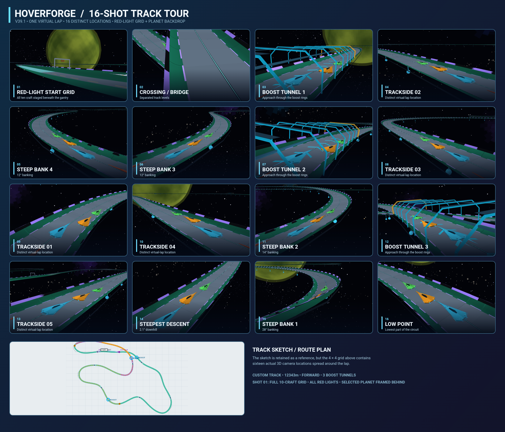
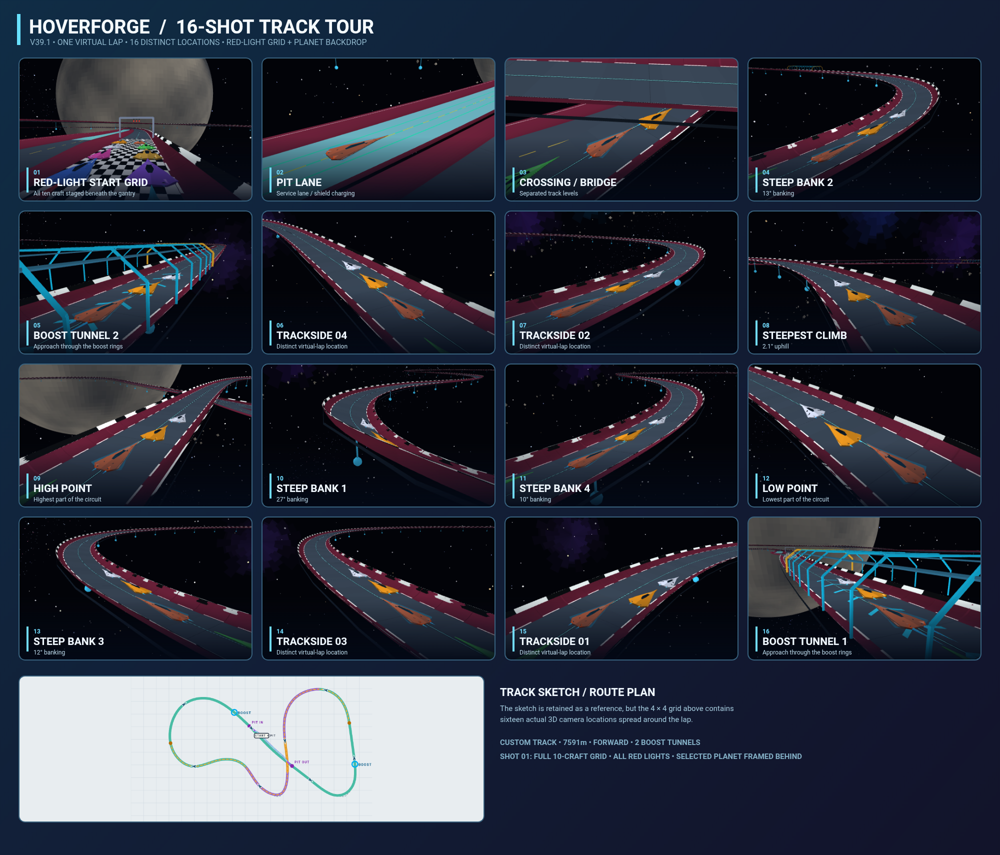
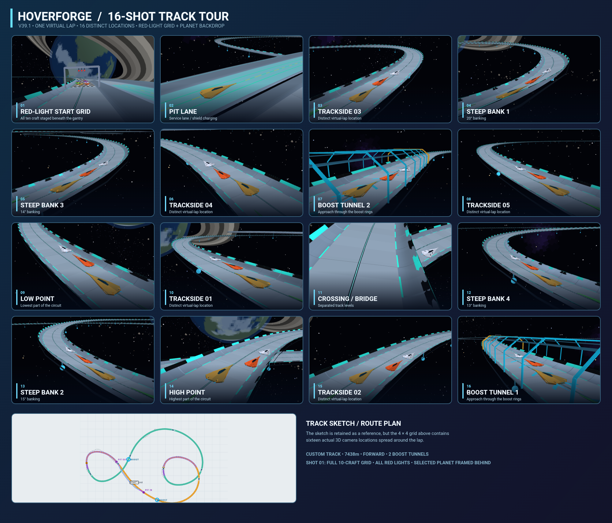
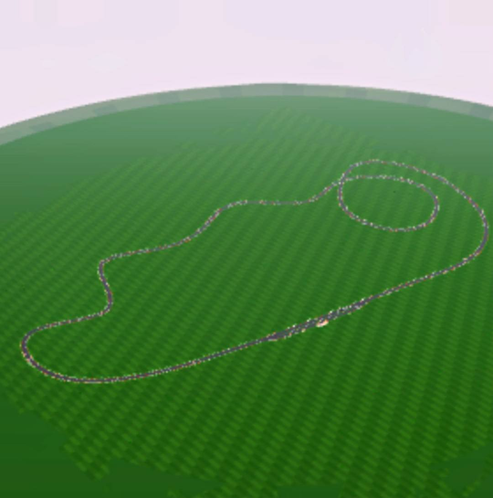
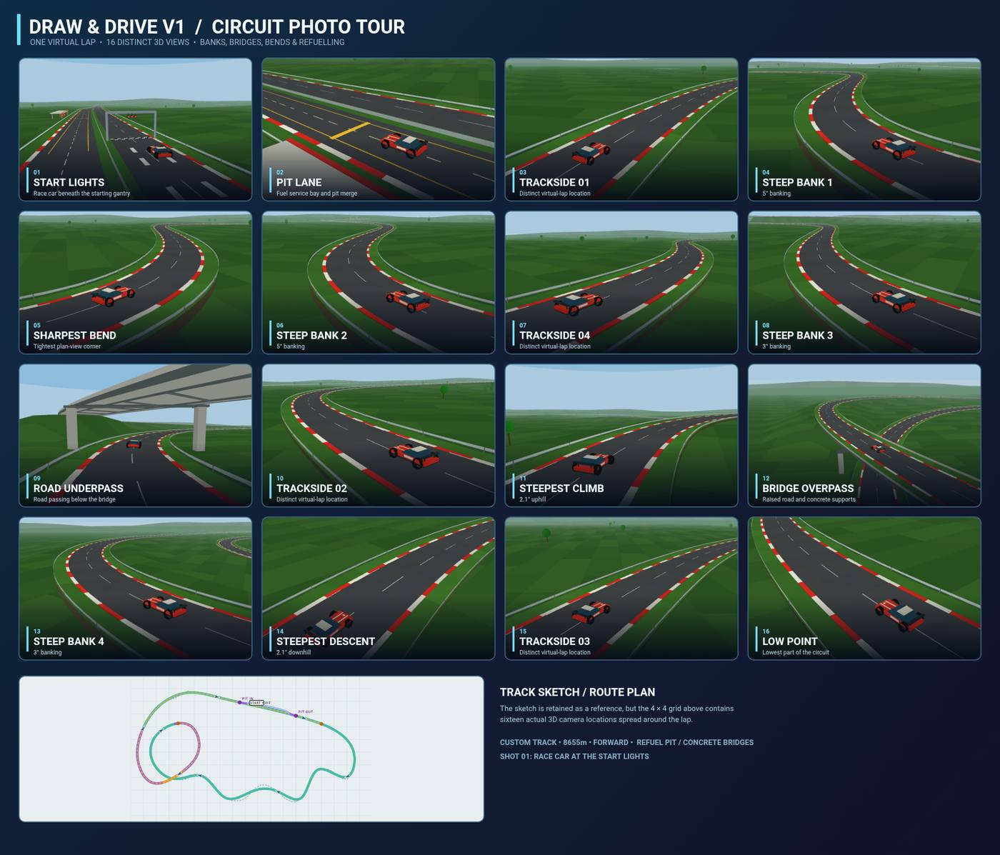
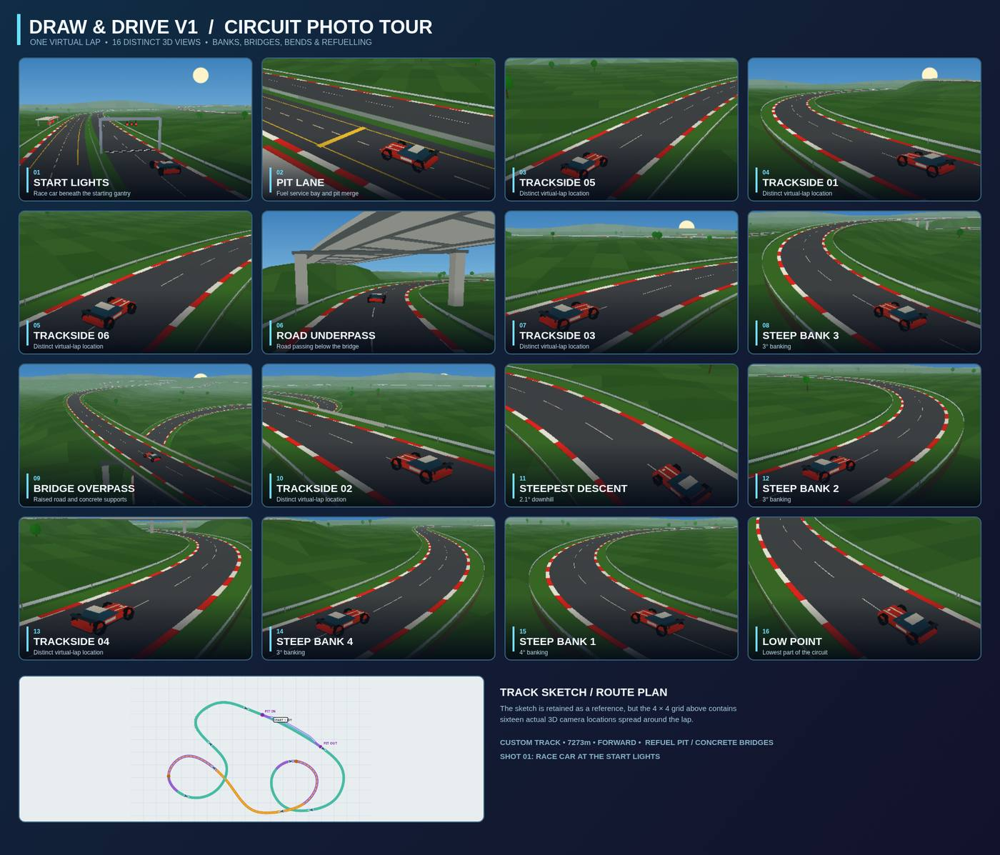

# Hyperforge V1 + Draw & Drive V1

**Two browser racing games. Draw a circuit, build it, and race it.**

This repository contains two separate, self-contained HTML games. **Hyperforge V1** is the original futuristic hover racer and track maker. **Draw & Drive V1** is an additional conventional race-car and procedural-terrain prototype developed from the track-building ideas.

## Play the games

| Game | Open in your browser | What it is |
| --- | --- | --- |
| **Hyperforge V1** | **[Play Hyperforge](index.html)** | The original sci-fi hover racer, pilots, planets, AI opponents, banked roads and space scenery |
| **Draw & Drive V1** | **[Play Draw & Drive](DrawAndDriveV1.html)** | Daylight race-car prototype, wider asphalt, kerbs, grass run-off, crash barriers, concrete bridges and refuelling |

For the hosted version, use [Hyperforge V1](https://rickey1990.github.io/HoverForgeV1/) or [Draw & Drive V1](https://rickey1990.github.io/HoverForgeV1/DrawAndDriveV1.html). GitHub Pages needs to be enabled for these URLs to work. Otherwise download the HTML file and open it locally in Chrome or another modern browser. No installation, external game engine or build process is required.

## Hyperforge V1 — original game

- Freehand 2D circuit drawing and automatic 3D banking, elevation, slopes and crossings.
- Combined START + PIT module, boost tunnels, shields and damage.
- Ten selectable alien/robot/creature pilots and colourful low-hover craft.
- Arcade opponents with independent racing lines and passing.
- Space skies with planets, moons, stars and nebulae.
- Keyboard, touch and controller support; project JSON save/load.
- **16-photo track tour** with distinct 3D viewpoints and a track sketch.

### Hyperforge screenshots

| Mobile race view | Race HUD |
| --- | --- |
|  |  |

#### Hyperforge 16-shot track tours

## Draw & Drive V1 — bonus race-track prototype

**[Open Draw & Drive V1](DrawAndDriveV1.html)**

Draw & Drive is a separate early-3D-inspired circuit prototype: it keeps the freehand road-building concept but swaps hovercraft and space scenery for a **low-poly race car, daylight sky and generated grassy terrain**.

- Draw and solve a closed track, including banked bends, elevation and crossing layouts.
- Asphalt roads with red-and-white kerbs, grass run-off and roadside barriers.
- Grass slows the car; barrier impacts cause damage.
- Concrete flyovers, underpasses, support pillars, earth banks and cuttings.
- Refuelling pit lane instead of shield charging.
- Gentler, adjustable steering for mobile/touch play.
- **16-photo circuit collage** featuring different camera positions, pit, bridges, bends and the track sketch; save it as a PNG.
- Single-file HTML; runs offline in a compatible browser.

### Draw & Drive screenshots

#### 3D circuit overview

#### 16-shot camera collage — example circuit 1

#### 16-shot camera collage — example circuit 2

## Getting started

1. Open **[Hyperforge V1](index.html)** or **[Draw & Drive V1](DrawAndDriveV1.html)**.
2. Sketch a closed circuit or choose an example.
3. Build/solve the track and inspect any geometry warnings.
4. Add race pieces or adjust the look.
5. Start driving, then use the camera/track-tour controls to save photos.

**Desktop:** Arrow keys or A/D to steer; Space to drift/brake. Hyperforge also has boost and pit controls.  
**Mobile:** Use the on-screen steering, drift and pit controls.

The two games are independent; a saved project from one is not guaranteed to load into the other.

## Files

- `index.html` — original Hyperforge V1 game.
- `DrawAndDriveV1.html` — separate Draw & Drive V1 prototype.
- `assets/` — screenshots used in this README.
- `LICENSE` — MIT license.

## Status and license

Both games are experimental browser projects. Track-building and WebGL rendering may vary across devices. Released under the **MIT License**; see [LICENSE](LICENSE).
